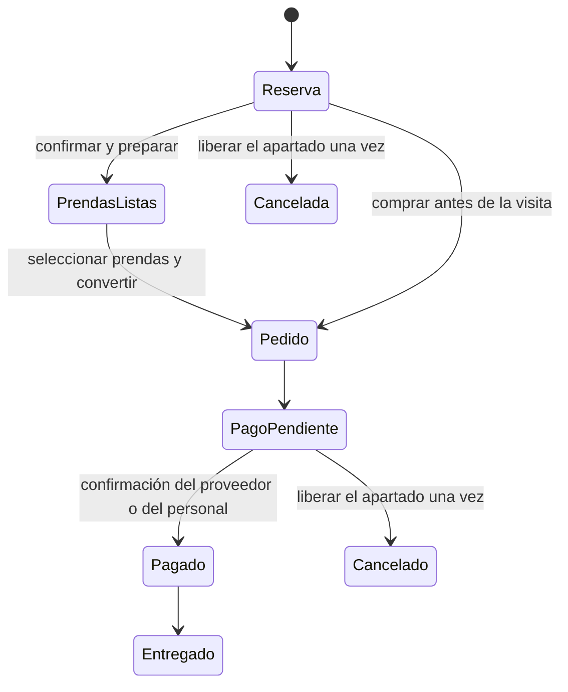

# Recorridos comerciales SaaS · 07/11/2026

## Una reserva también puede terminar en compra

La reserva descuenta disponibilidad una sola vez. El cliente o el personal autorizado selecciona las prendas que compra y crea un pedido vinculado; se liberan únicamente las cantidades que rechaza. El servidor calcula el precio vigente y los descuentos. El cliente revisa el total antes de pagar.

`reservations.order_id` es único. Un reintento devuelve el mismo pedido; otro contenido se rechaza. Una reserva convertida no se cancela para liberar inventario: se gestiona su pedido. Las reservas históricas atendidas pueden convertirse, pero necesitan disponibilidad real porque su apartado ya se había liberado.

El pedido de una reserva se retira en su sucursal. Después de acreditar el pago, el personal puede registrar el retiro desde «Pagado» o «En preparación»: no se exige transportista ni número de envío. El retiro no descuenta otra vez el inventario. Web y móvil muestran este recorrido sin «En camino», y el pedido entregado permite solicitar un cambio. Los pedidos a domicilio conservan sus etapas de preparación, envío y entrega.

## Última prenda y operación sin conexión

Dos dispositivos desconectados no pueden conocer sus operaciones mutuamente. Las ventas de contado y reservas locales son provisionales, con folio y estado visible, hasta que el servidor las confirma. No se simula un cobro de tarjeta sin conexión.

Al sincronizar, venta, reserva y conversión comparten bloqueos de inventario. Con una sola talla M disponible, solo una operación puede consumirla; la otra conserva un conflicto revisable. Los reintentos son idempotentes y no descuentan existencias dos veces.

Se corrigió además el primer registro simultáneo del mismo dispositivo: el alta usa un savepoint y, ante un registro concurrente, relee la fila ganadora y valida su estado bajo bloqueo. No se duplica la auditoría ni se ignora un dispositivo bloqueado. Una barrera en las pruebas PostgreSQL reproduce de forma determinista la carrera que antes devolvía `503` por un duplicado en `devices`.

Si una venta en efectivo se ajusta, queda pendiente la diferencia entre el total original y el aceptado. Si se cancela por conflicto, queda pendiente el total original. Resolver el conflicto no certifica que el dinero se entregó. El personal registra en línea el importe exacto y la referencia de caja, después de entregar el efectivo. Una segunda confirmación incompatible se rechaza. El dispositivo recibe el estado del reintegro al consultar de nuevo; no reenvía la venta confirmada.

## Cambiar una prenda es distinto de devolverla

Los dos circuitos comparten las cantidades disponibles del pedido: una unidad comprometida en una solicitud no se puede volver a devolver o cambiar en mostrador. Se comprueban empresa, dueño, sucursal autorizada, pedido pagado y entregado, plazo y disponibilidad del reemplazo. El plazo de cambio procede de la política de la empresa.

El crédito de la prenda original se calcula sobre lo realmente pagado, repartiendo descuentos y centavos sin perder ni crear dinero. La prenda nueva usa el precio vigente del servidor. Los precios enviados por el dispositivo no determinan el cobro.

| Diferencia | Trámite |
|---|---|
| Cero | Aprobar, recibir la original y completar la entrega del reemplazo. |
| Positiva | Aprobar y cobrar solo la diferencia con Stripe Connect, o confirmar el efectivo en sucursal con importe y referencia. Después se completa la entrega. |
| Negativa | Reintegrar la diferencia al pago Stripe original o registrar la entrega exacta de efectivo, antes de completar el cambio. |

El reemplazo se aparta al solicitar el cambio; la original vuelve a inventario al recibirse físicamente. Aprobar una solicitud no acredita un pago ni certifica una recepción. Un fallo o reintegro pendiente de Stripe conserva la solicitud pendiente de cierre. Los webhooks firmados verifican cuenta, sesión, moneda, importe y referencia; no mueven prendas por sí mismos.

Si se rechaza un cambio cuya diferencia ya se cobró con Stripe, se exige primero el reintegro confirmado de ese cobro. Si se acepta efectivo después de abrir Checkout, se expira la sesión sin pagar para evitar un segundo cobro. Las sesiones vencidas pueden renovarse con una nueva clave de intento persistente.

El mostrador valida cantidades contra ambos circuitos, usa precios del servidor, bloquea las variantes en orden y exige una clave de intento. Su reintegro Stripe utiliza la cuenta original que cobró el pedido, aunque la empresa cambie después su cuenta conectada.

## Dos cobros distintos con Stripe

- **FashionStore cobra a las empresas:** Billing, Checkout de suscripción, portal de facturación y webhooks del plan. La empresa lo ve en «Plan y facturación».
- **Cada empresa cobra sus prendas:** Accounts v2 para las altas y cargos directos con `Stripe-Account`. La empresa configura su cuenta en «Cobros de prendas». No entrega claves secretas de su cuenta a FashionStore.

La implementación conserva el modo de prueba. Las pruebas usan un proveedor simulado y avisos firmados de prueba; no se movió dinero real. Para una prueba con Stripe real se necesitan las claves de prueba, los precios mensuales de los planes, los secretos de ambos webhooks y cuentas Connect habilitadas.

### Alta Accounts v2 · revisión del 07/11/2026

El alta usa `POST /v2/core/accounts`, cuerpo JSON y versión `2026-10-28.endive`. Solicita la configuración `merchant` con `card_payments`, panel `full` y responsabilidades de comisiones y pérdidas a cargo de Stripe (`fees_collector=stripe`, `losses_collector=stripe`). La cuenta sandbox existente rechazó que la plataforma asumiera las pérdidas sin completar su configuración adicional. No se usa la variante Express con Managed Risk, que Stripe documenta como preview.

La empresa se obtiene del token. La creación se serializa por empresa, usa clave de idempotencia y guarda únicamente el ID y el estado. Nunca acepta un ID de cuenta aportado por otra empresa. Una respuesta sin `object=v2.core.account`, `livemode=false` e ID `acct_` se rechaza. Solo se admiten claves `sk_test_`.

El formulario alojado y la lectura de estado usan la compatibilidad documentada de las cuentas v2 con `account_links` y `GET /v1/accounts/{id}`. Se conservan los webhooks snapshot `account.updated` y los de Checkout de cuentas conectadas; no se necesitan nuevos destinos thin para este circuito. «Actualizar estado» consulta Stripe y persiste el resultado; regresar del formulario no habilita cobros por sí mismo. Un enlace vencido solicita otro enlace y sus errores siguen visibles aunque no se haya cargado la tarjeta de cuenta.

`STRIPE_CONNECT_TEST_COUNTRY=US` es el valor predeterminado exclusivamente para las cuentas ficticias. No habilita operar en vivo en ese país ni sustituye la elegibilidad de una empresa real. El código no carga identidades ni bancos ficticios en las cuentas normales de las empresas. El titular completa los datos y acepta las condiciones en Stripe; el servidor no acepta esas condiciones en su nombre.

Validación realizada durante esta revisión: se creó una cuenta v2 en la cuenta Stripe TEST elegida por el usuario, se comprobó su representación compatible v1 y se generó su enlace de alta; sus cargos seguían deshabilitados por requisitos pendientes. Pasaron 31 pruebas focalizadas de backend, 815 pruebas generales y 697 pruebas web con compilación. Las pruebas locales cubren separación A/B, webhook del pago, idempotencia, incompatibilidad de cuenta, bloqueo de clave live y permisos. La prueba externa de venta sobre una cuenta v2 completamente habilitada y el push de esta revisión permanecen pendientes; no deben deducirse de los resultados unitarios. La revisión automática de operaciones externas se interrumpió por falta de créditos del workspace.

Referencias de Stripe: [Accounts v2](https://docs.stripe.com/connect/accounts-v2), [responsabilidades y panel](https://docs.stripe.com/connect/accounts-v2/connected-account-configuration), [Managed Risk](https://docs.stripe.com/connect/risk-management/connected-accounts-with-managed-risk). Esta revisión no requiere migraciones.

## Configuración y datos por empresa

### Avisos destacados de pagos y operaciones · 07/11/2026

`GET /api/v1/notifications` deriva el historial de pedidos, reservas, cambios y comprobantes del plan. Incluye `event_key`, `importante` y `tono`. Aplica empresa del token, titular del pedido y permisos; el personal solo recibe operaciones de sus sucursales autorizadas. La plataforma recibe los comprobantes de suscripción, sin mezclar las ventas de tiendas. La sesión de soporte no recibe avisos personales de facturación.

Los pagos acreditados, la confirmación de reservas, cancelaciones, vencimientos y resoluciones de cambios generan avisos destacados. Los cambios distinguen aprobación, cobro de diferencia y reintegro confirmado. Una diferencia negativa pendiente no se anuncia como dinero devuelto. Los comprobantes del plan distinguen pendiente, vencido y pagado con fecha de pago. Los eventos conservan una clave estable para evitar ventanas repetidas.

La web consulta novedades cada 45 segundos mientras está visible y al recuperar foco o conexión. Las acciones de pago muestran el resultado inmediatamente después de la respuesta del servidor. Android incorpora ventanas globales y «Mi cuenta → Avisos y pagos». El historial conserva los avisos cerrados. Se descartan respuestas de otra sesión y se separa el recuerdo de avisos por usuario y empresa. Esto cubre avisos dentro de la aplicación abierta; no incorpora notificaciones remotas con la aplicación cerrada.

Verificación: 799 pruebas unitarias backend, 697 web y 334 móvil aprobadas (una prueba externa móvil omitida), análisis móvil sin problemas y compilación web. `test_payment_notices.py` comprueba Checkout con cuentas A/B, firma de webhook, repetición, destinatarios, sucursales, cobro del plan y reintegros. El ensayo de navegador `payment-notices.mjs` crea una compra, comprueba un retorno falso sin acreditar, confirma mediante webhook firmado local y verifica ventana, importe, referencia, ausencia de repetición y aislamiento de B. Se inspeccionaron capturas en escritorio y a 390 px. Todas las operaciones financieras del ensayo son simuladas; no certifican la configuración de una cuenta Stripe externa.

«Configuración de la empresa» agrupa tienda pública y marca, perfil, plan, medios de cobro y datos. Permite editar color, eslogan, información, contacto, políticas, SEO, logo y portada; publicar o despublicar; y gestionar medios manuales. Publicar comprueba suscripción, sucursal con horario, logo, catálogo con fotografías y medios de cobro. Cada tienda conserva `/tienda/:slug` y su catálogo propio.

Las copias de negocio por empresa, su programación y su ensayo se describen en [RESPALDOS-POR-EMPRESA.md](RESPALDOS-POR-EMPRESA.md). La custodia necesita `TENANT_BACKUP_ENCRYPTION_KEY`; no se inició ninguna copia real de producción durante el trabajo.

## Plataforma y reportes de empresa

El panel ejecutivo global usa cobros de suscripciones registrados como pagados, empresas, planes, vencimientos, distribuciones, series y detalle filtrable. MRR y tendencia se identifican como estimaciones. El volumen comercial de las tiendas se muestra separado de los ingresos de FashionStore. Las cifras están expresadas en BOB y excluyen empresas de demostración.

Exporta XLSX con gráficos, PDF con gráficos y tabla, o CSV, sobre el mismo período y filtros aplicados. Se conservan los reportes empresariales y sus exportaciones; se corrigió la lectura del panel ML y de la pantalla de cambios.

## Alcance de las migraciones

- `20261125_0044`: políticas y cola de copias cifradas por empresa, con aislamiento y permisos de acceso.
- `20261126_0045`: vínculo de reserva a pedido, liquidación del cambio, sesiones de diferencia e identificación de reintentos de mostrador.

No convierten reservas históricas automáticamente ni reescriben importes de operaciones anteriores. El camino limpio, la correspondencia del ORM y la reversión se ensayan en PostgreSQL local antes de publicar.

## Evidencia de cierre

- Backend: 790 pruebas aprobadas; 18 omitidas en la ejecución sin servicios externos. Los ensayos que necesitan PostgreSQL se ejecutaron también por separado: 17 aprobados, incluyendo migración completa y reversión, coincidencia ORM, RLS y concurrencia por la última unidad.
- Web: 666 pruebas y compilación de producción aprobadas en una copia que excluye las ediciones concurrentes de autenticación. La prueba del probador espera el primer fotograma procesado, en lugar de depender de una pausa fija.
- Móvil: análisis estático sin problemas, 307 pruebas aprobadas y APK debug compilado. No equivale a una prueba en un teléfono físico.
- Validación adicional del retiro: 148 pruebas focalizadas del backend y 16 comprobaciones del mismo grupo PostgreSQL que ejecuta CI, aprobadas. El control remoto anterior aprobó pruebas generales y migraciones, pero falló en su grupo PostgreSQL; se añadieron anotaciones de fallo para obtener el caso exacto si se repite.
- Diagnóstico del control remoto: las anotaciones identificaron los dos casos de sincronización concurrente. La barrera local reprodujo ambos fallos (`23505`, tabla `devices`) antes del arreglo. Después pasaron 36 pruebas: todo el grupo PostgreSQL de CI más dispositivos y operación offline, manteniendo la barrera y verificando una sola auditoría de alta.
- Navegador con API y SQLite locales: configuración pública y medios de cobro; reserva → pedido sin descontar dos veces → pago → retiro sin envío → cambio en mostrador; cambio solicitado de precio distinto con cobro y recepción; panel ejecutivo con filtros, gráficos y XLSX; copia de empresa A restaurada y descargada; empresa B sin acceso a sus copias; reportes empresariales conservados. Sin errores HTTP ni de página en esos recorridos.
- Stripe simulado: Checkout cobra solo la diferencia, reutiliza sesión, valida avisos firmados y cuenta conectada, y conserva pendiente un reintegro fallido. No se procesaron cargos ni reintegros reales.

Ensayo reproducible: `python tests/e2e/saas_workflows_server.py` en el backend y las instrucciones de `frontend/scripts/qa/README-SAAS.md` en la web. Los datos, contraseñas y claves de ese entorno son exclusivamente sintéticos.
